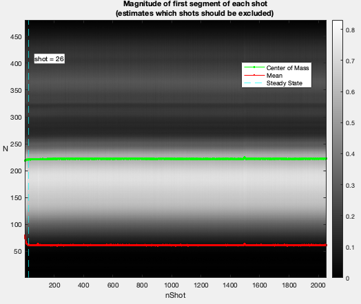
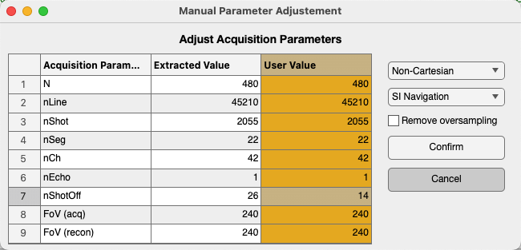
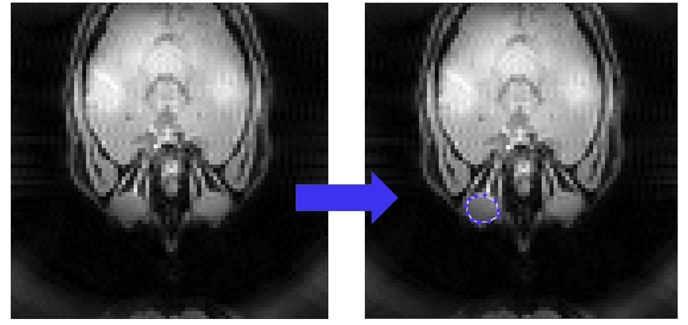

============
The Mitosius
============

Creating the Mitosius is the last preparation step before the reconstruction. This section covers how to prepare the mitosius.

You have already run the coil sensitivity estimation or had an estimate of coil sensitivity by your own procedure (see the :doc:`Coil Sensitivity Map Estimation <2-5_coil_sensitivity_map>`). You need to have access to the raw data of the acquisition (of course :)).

This script is designed to process Siemens raw MRI data/ISMRMRD using various monalisa functions to load raw data, initialize parameters, compute trajectory points and volume elements, normalize the data, and generate the output "mitosius". The resulting mitosius contains raw data, the computed trajectory and the volume elements for each bin.

.. important::
    Keep in mind that the trajectory must be supported by the toolbox; alternatively, you can define and implement a custom trajectory following our suggestion at the end of the section (see the section :ref:`Custom Trajectories <customTrajectories>`).

Prerequisites
=============
Ensure you have the following files and paths correctly set up:

- Siemens raw data file. (Or ISMRMRD file)
- Precomputed coil sensitivity matrix (C.mat).
- Precomputed binning mask (Mask.mat)

Additionally, monalisa must be installed with the raw-data readers (``pip install -e ".[io]"``, see :doc:`1-2_installation`). The examples below assume

.. code-block:: python

    import numpy as np
    import scipy.io as sio
    import monalisa as ml
    from monalisa.io import loadmat73

.. tip::
    In MATLAB, the help function `bmTwix_info` inspects the acquisition parameters of a 3D radial raw data file. It is not part of the recon procedure and is not ported to Python: in Python, the reader created below prints its parameters with ``print(reader.acquisitionParams)``.

Usage instructions
==================

Define the Paths
----------------

.. code-block:: python

    # Paths - Replace for your own case
    f = "/your/path/to/raw_data/rawdata.dat"
    CMatPath = "/your/path/to/C/C.mat"
    MaskPath = "/your/path/to/Mask/Mask.mat"
    mitosiusPath = "/your/path/to/save/mitosius/"

Load the Raw Data
-----------------

.. code-block:: python

    autoFlag = False  # Set whether the validation UI is shown
    # Create the appropriate reader based on the file extension
    reader = ml.create_raw_data_reader(f, autoFlag)

In our examples, we often use 3D radial trajectory. In that case, the raw data reader will check the first segment of each shot to estimate after how many nLines, steady state is reached.
For your own trajectory, you can find your own way.

(The image title is yet to change. The screenshots on this page are from MATLAB; the Python windows show the same information.)

The acquisition parameters will be extracted automatically, if possible.

You can also modify the parameters manually in the "User Value" column (in yellow), for example: adjusting `nShotOff` according to your needs. If you want to include all the lines for reconstruction, set `nShotOff = 0`. Then click the "Confirm" button.

With ``autoFlag = True`` no window is shown, and the parameters can be changed in the code instead, for example ``reader.acquisitionParams.nShot_off = 0``.

Add MRI Acquisition Parameters
------------------------------

Save the acquisition parameters into `p` and add other parameters you may need.

.. code-block:: python

    p = reader.acquisitionParams
    p.selfNav_flag = True
    p.traj_type = "full_radial3_phylotaxis"

    # Initialize and fill in the parameters:
    # p.raw_N_u: acquisition matrix size (identified from your acquisition protocol)
    p.raw_N_u = np.array([[480, 480, 480]])             # optional, just for records
    p.raw_dK_u = np.array([[1.0, 1.0, 1.0]]) / 480      # optional, just for records

Read the raw data and compute trajectory points, volume elements
----------------------------------------------------------------

.. code-block:: python

    # Read raw data
    # get raw data without nshotoff and SI
    flagSS = True
    flagExcludeSI = True
    # flagSS: if true, filter out the non steady state shots
    # flagExcludeSI: if true, filter out the SI projections
    y_tot = reader.read_raw_data(flagSS, flagExcludeSI)

    # compute trajectory points
    # get 'full_radial3_phylotaxis' trajectory without nshotoff and SI
    t_tot = ml.traj(p)
    # alternatively you can compute your own trajectory
    # more details in "Custom Trajectories"

    # compute volume elements (3D full radial trajectory in this case)
    ve_tot = ml.volume_element(t_tot, "voronoi_full_radial3")

Load the Coil Sensitivity Matrix
--------------------------------

Resize the coil sensitivity matrix to match the reconstruction matrix size.

.. tip::
    Here we want to clarify the distinction of the concepts between "Reconstruction matrix size" and "Acquisition matrix size"

    - Acquisition matrix size: This refers to the matrix size specified by the acquisition protocol. It was already set at the acquisition step by the experimenters.

    - Reconstruction matrix size `Matrix_size`: This is set by the user based on the desired resolution of reconstructed images, i.e. the size of the reconstructed image.

    - N_u: The size of reconstruction grid in Fourier space. For example, we can set `N_u = Matrix_size`.

        - :math:`N_u = [N_x, N_y, N_z]`

    - n_u: The size of reconstruction in image space. It is possible to set `n_u ≤ N_u`. However, we recommend setting `n_u = N_u` for achieving the optimal image quality.

        - :math:`n_u = [n_x, n_y, n_z]`

    - dK_u: The step size of the grid in Fourier space, calculated as `dK_u = 1/Fov`.
        - :math:`dK_u = [dK_x, dK_y, dK_z]`

.. code-block:: python

    C = loadmat73(CMatPath)["C"]  # a -v7.3 file, as written by monalisa; else sio.loadmat(CMatPath)["C"]
    # N: reconstruction matrix size
    N_u = np.array([[N, N, N]], dtype=np.float64)
    n_u = N_u
    dK_u = np.array([[1.0, 1.0, 1.0]]) / FoV
    C = ml.im_resize(C, [48, 48, 48], N_u)

Normalize the data
------------------

Normalize the raw data by the average value of a region of interest (ROI). The goal is to adjust the intensity values of the image so that they are centered around a mean of 1 in the ROI.

.. important::
    Keep in mind that whether or not normalization is applied, the regularization weight in the final reconstruction step should be adjusted accordingly. Our normalization helps standardize the regularization weight.

.. code-block:: python

    x_tot = ml.mathilda(y_tot, t_tot, ve_tot, C, N_u, n_u, dK_u)
    ml.show_image(x_tot)
    temp_im = np.abs(x_tot[:, :, N // 2])  # the slice to draw the ROI on (MATLAB: the displayed one)
    temp_roi = ml.roipoly(temp_im)

Here an estimation of the reconstructed image will be shown and you can select the ROI based on it.

We selected the left eye globe as the ROI in our example below, you can also select yours with a larger area in the brain.

- Left Click: Adds a vertex at the clicked position.
- Click on the first vertex: Completes the polygon and closes it (MATLAB: right click or double click). The vertices can then be moved; press "Confirm".

The vertices are printed, so that the same ROI can be rebuilt later without the window:
``ml.roipoly(temp_im, c, r)`` with the printed column and row coordinates.

.. code-block:: python

    normalize_val = np.mean(temp_im[temp_roi])
    # normalize it only once
    y_tot = y_tot / normalize_val

Cleaning of the mask
--------------------

For some trajectories, such as the 3D radial trajectory, it is necessary to clean the SI projection and remove the first unsteady shots from the acquired readouts. Therefore, we also need to clean the binning mask accordingly to ensure that the size of `Mask` matches the size of `y_tot`.

.. code-block:: python

    Mask = sio.loadmat(MaskPath)["Mask"].astype(bool)  # MATLAB logical arrays are loaded as uint8
    Mask = np.reshape(Mask, (20, 22, 2055), order="F")  # column-major, as MATLAB reshape
    # before cleaning, the size of Mask: [nBin, nSeg, nShot]
    Mask = Mask[:, 1:, :]
    Mask = Mask[:, :, int(p.nShot_off):]
    # after cleaning, the size of Mask: [nBin, nSeg-1, nShot-p.nShot_off]
    Mask = ml.point_reshape(Mask)
    # after the reshape, the size of Mask: [nBin, nLines]
    # where nLines=(nSeg-1)*(nShot-p.nShot_off)

Compute Final Data Structures for Reconstruction
------------------------------------------------

Run the `mitosis` function and compute the final volume elements.

.. code-block:: python

    y, t = ml.mitosis(y_tot, t_tot, Mask, nargout=2)
    y = ml.permute_to_col(y)
    ve = ml.volume_element(t, "voronoi_full_radial3")

Save the Results
----------------

Save the computed data structures to disk. These will be used for the final reconstruction.

.. code-block:: python

    ml.mitosius_create(mitosiusPath, y, t, ve)

The mitosius is a folder of MATLAB ``-v7.3`` files: a mitosius written by Python can be loaded by MATLAB's ``bmMitosius_load``, and the reverse.

Notes
=====

- Ensure all paths are correctly set according to your system.
- If you encounter issues with reading the raw data, verify that monalisa is installed with the raw-data readers (``pip install -e ".[io]"``).
- The raw data normalization step ensures that the average value in the selected ROI ranges around the mean of 1 in the reconstructed images. This allows the standardization of the regularization weights.
