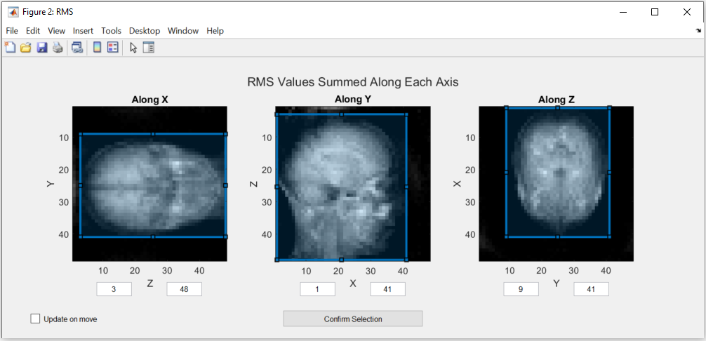
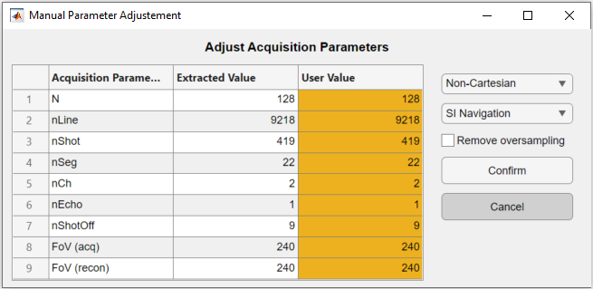
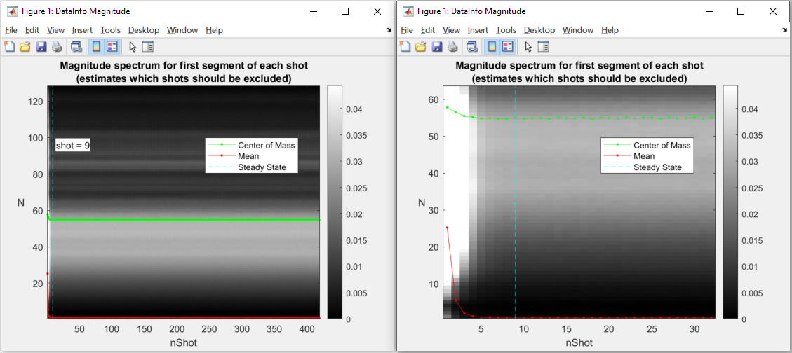
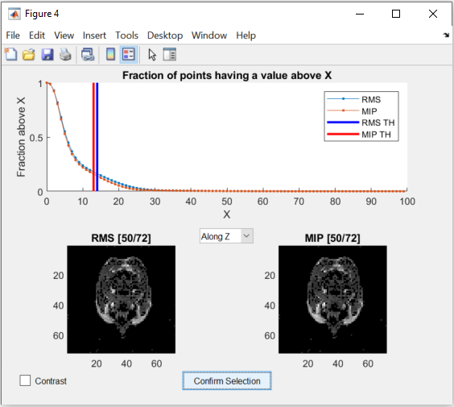
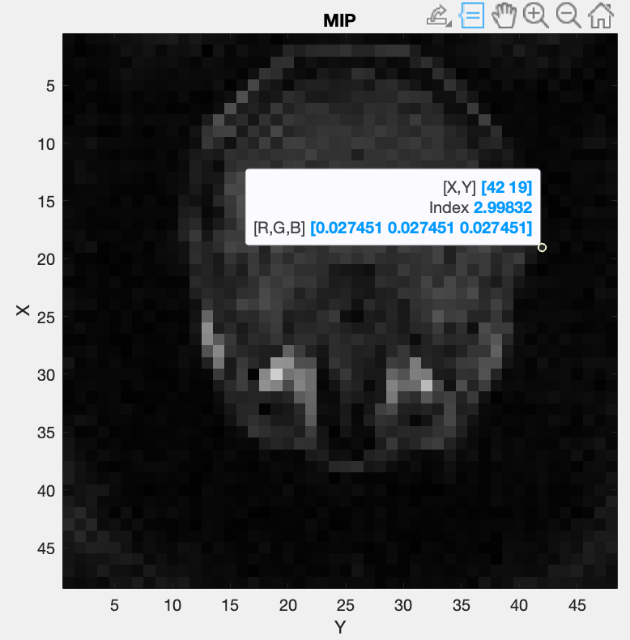
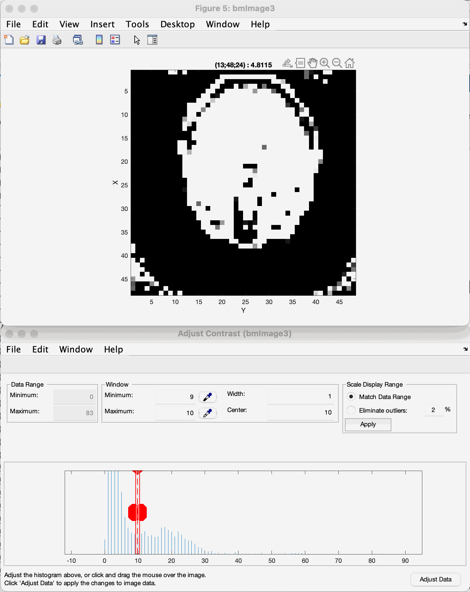

===============================
Coil Sensitivity Map Estimation
===============================

.. contents::
   :local:

This section explains how to generate an estimate of the coil sensitivity map using this framework.

.. warning::
   For this, an acquisition of the body coil pre-scan and the selected acquisition coil pre-scan data is required. Either you need pre-scan images or two pre-scan raw data sets.
   For the moment we only support ISMRMRD (.mrd) and Siemens raw data (.dat) files.

Coil sensitivity from pre-scan images
=====================================

Computing coil sensitivity from pre-scan images is simpler but yields a worse estimation of the real coil sensitivity. You need two body coil images and one image per acquisition coil.

.. warning::

   The FOV position and orientation of the images should be the same.

.. note::
   This method is available in **MATLAB only** (``bmCoilSense_prescan_coilSense`` is not ported to Python yet).

This script https://github.com/MattechLab/monalisa/blob/main/examples/scripts/coilSense_from_prescan_images_script.m illustrates how to run the coil sensitivity estimation from prescan images. The estimation of the coil sensitivity is done in two steps:
1. In the first step, the user should define a pre-scan mask on the ROI using the body coil image, this helps to estimate the coil sensitivity excluding the noise.
2. In the second step, the function bmCoilSense_prescan_coilSense is called to estimate the acquisition coils sensitivities.

The images are required to be 3D MATLAB arrays.

Coil sensitivity from raw data pre-scans
========================================

The process of extracting the acquisition metadata and the parameters for the generation of the ROI mask can either be done automatically or controlled by the user.
The used mode is chosen by a flag, ``autoFlag``, given to the raw data readers and to the mask creation (see :ref:`Code Explanation <codeExplanation>`).

.. warning::

   The FOV position and orientation of the raw-data pre-scans should be the same.

.. code-block:: python

   # Flag; decide on values automatically if true, require user input if false
   autoFlag = True

The paths to the files and to the folder where the map should be saved are set at the start of the script.
The resulting map is only saved if the save flag is set to true.

.. code-block:: python

   # Flag; saves the coil sensitivity map if true
   doSave = True

Unlike the MATLAB script, the Python code opens no file selection dialog: the paths of the body coil file, of the surface coil file and of the folder where the result is saved are given in the code.

.. _automatedEstimation:

Automated Estimation
====================

In automated mode (``autoFlag = True``), no window is opened: the thresholds that separate the
signal from the noise and the bounding box of the region of interest (ROI) are found
automatically. The chosen values are printed, and can be given explicitly to reproduce or adjust
the mask without windows (see :ref:`Mask Creation <maskCode>`).

The ROI is essential for estimating the coil sensitivity: it should completely encompass the area you wish to image, but be the smallest possible bounding box. Pixels outside this region are estimated by solving the Laplace equation:

.. math::
   \Delta f = 0

When the box is chosen by hand (``autoFlag = False``), the selection is made in a window showing the
Root Mean Square (RMS) values and the Maximum Intensity Projection (MIP) summed along x, y and z (six
images; MATLAB opens two figures, one for RMS and one for MIP). The box can be modified by dragging
its edges in any of the images, which updates the others, or by typing its limits. The code
execution is interrupted until confirmation. The screenshots on this page are from MATLAB:

.. note::
   The images in this figure are created by summing along an axis to represent the view.
   If this option doesn't create a usable image, please use the :ref:`figures <roiFigures>` in the manual estimation mode.

   The minimum and maximum values can only be changed directly in manual estimation.

After checking that the ROI is correct, the selection has to be confirmed by pressing the "Confirm Selection" button.

The rest of the estimation is done automatically. In Python, save the resulting matrix yourself, for instance with ``monalisa.io.savemat73`` (see :ref:`Improved Estimation <ImprovedEstimation>`); the MATLAB script names it

   ``coil_sensitivity_map_yyyy-mm-dd-hh-mm.mat``

Manual Estimation
=================

Using the manual estimation requires some more confirmation from the user. Namely of the parameters extracted and the threshold to differentiate between noise and data.
There will be more figures shown that allow checking the region of interest in more detail.

Acquisition Parameters
----------------------

The acquisition parameters are automatically extracted from the raw data files and presented in the following figure. Make sure that the values displayed are correct.

The code execution is interrupted until the window is confirmed.
The table allows the user to modify the extracted acquisition parameters in the third column "User Value".
On the right, the navigation and the trajectory type can be selected, as well as an option to remove oversampled data.

.. note::
   Only the non-cartesian trajectory and the navigation using the SI line are implemented.

This has to be done for the body coil first and then for the surface coils.
To select a good number for the shots to be dropped as they are taken before the steady state is reached, a figure is shown.
The figure indicates which number was selected automatically.

Here is the figure for the SI navigation together with the same figure zoomed into the first few shots:

Note that the number of shots to be discarded can be updated by dragging the vertical line in this figure.

.. warning::
   Only the number of channels (coils) will be stored from the body coil.
   The changes to the other parameters have to be done in the second figure for the surface coils.

Mask Creation
-------------

The mask is used to select voxels for which valuable data is present. This should exclude artifacts and noise.
To achieve this, thresholds and a region of interest (ROI) selection are used to create the mask.

Threshold
^^^^^^^^^

To ensure that the estimation is only done for voxels that contain meaningful data, a threshold is used to separate noise from data.
One threshold is for the RMS value of the voxels, which is calculated over all the body coils and the other is for the MIP value.
Both of them are set separately by dragging the two lines in the figure below:

The figure allows changing the view of the two images as well as changing between a binary and a continuous representation.
While dragging the lines in the graph in the top half, the images update the voxels to show which are below the threshold.

.. _roiFigures:

Region of Interest
^^^^^^^^^^^^^^^^^^

The selection of the ROI is done the same way as in the :ref:`Automated Estimation <automatedEstimation>`.
But additionally, the RMS values and the MIP values are shown as 3D images (with ``show_image``,
in the notebook or in a napari window).

These figures allow a closer inspection of the image.
This can be used to more precisely find the ROI and threshold values.
In a napari window, the coordinates and the value of the voxel under the mouse are shown in the status bar, while scrolling through the different views.

To further inspect the threshold, the contrast limits of the image can be changed (the "contrast limits" slider of the layer controls in napari, or the contrast slider of the notebook viewer).
By reducing the range of the allowed contrast, the image can be shown in a binary representation and a threshold value can be selected using the lower limit of the range.

Here is an example (MATLAB's "Adjust Contrast Tool"):

.. note::
   The view can be changed with the view selector (along x, y or z) of the viewer.

   Note that the coordinates shown change as well depending on the view.
   They are not always represented as (x, y, z), but depend on the axes shown.

Keep in mind that the goal of the thresholding is to remove as much noise as possible,
but to keep most of the information intact to achieve the best coil sensitivity estimation.
The example shown gives you an idea of correct thresholding, with most of the brain data maintained with only a small amount of residual noise in the corners, that will be filtered out by the bounding box selection.

Sensitivity Approximation
-------------------------

After the first estimation of the coil sensitivity, a heuristic gradient descent algorithm is applied to improve on this estimation.
This is done iteratively for a number of iterations that can be set in the script. For further explanation see `ImprovedEstimation`_.

In MATLAB, an image showing the combined image using the coils is generated after each gradient descent step. The Python port does not show these images (its ``display_flag`` argument is accepted and ignored); with ``nargout=2`` it returns the final image ``x``.

.. _codeExplanation:

Code Explanation
================

This part goes into a bit more detail of the code, which allows to more easily modify the coil sensitivity estimation process.
The complete code is the first step of the tutorial (:doc:`3-1_example1`). The examples assume

.. code-block:: python

   import numpy as np
   import monalisa as ml
   from monalisa.io import savemat73

Path selection
--------------

The script starts out by setting the two flags mentioned above. Afterwards, the paths of the files and the destination folder are set.

.. code-block:: python

   bodyCoilFile = "/your/path/to/bodyCoil.dat"
   arrayCoilFile = "/your/path/to/surfaceCoil.dat"

   saveFolder = "/your/path/to/results"

Parameters
----------

The acquisition parameters are then read by the raw data readers (one per file):

.. code-block:: python

   bodyReader = ml.create_raw_data_reader(bodyCoilFile, autoFlag)
   arrayReader = ml.create_raw_data_reader(arrayCoilFile, autoFlag)

``reader.acquisitionParams`` is an object of the class ``MriAcquisitionParam`` (MATLAB ``bmMriAcquisitionParam``) and is storing the acquisition parameters.
As this is the object used for the extraction of the data, its fields can be set manually, for
example to use the same number of discarded shots and the trajectory type for both files:

.. code-block:: python

   nShotOff = max(bodyReader.acquisitionParams.nShot_off, arrayReader.acquisitionParams.nShot_off)
   for r in (bodyReader, arrayReader):
       r.acquisitionParams.nShot_off = nShotOff
       r.acquisitionParams.traj_type = "full_radial3_phylotaxis"

The estimation is done on a low-resolution image to improve the result. The grid, which defines the resolution is set at the end of the section.

.. code-block:: python

   N_u = np.array([[48.0, 48.0, 48.0]])
   dK_u = np.array([[1.0, 1.0, 1.0]]) / arrayReader.acquisitionParams.FoV

This value can be changed to fit the user's needs. Good values range from 48 to 96. A too high resolution reduces the signal to noise ratio and increases execution time drastically.

Data extraction
---------------

In the function ``coil_sense_non_cart_data`` (MATLAB ``bmCoilSense_nonCart_data``), the raw data is extracted, the trajectory is generated and the volume elements are computed.

.. code-block:: python

   y_body, t, ve = ml.coil_sense_non_cart_data(bodyReader, N_u)

.. note::
   Both the trajectory and the volume element computation method have to be changed manually and the trajectory is not yet read out of the ISMRM raw data file.

Within the function ``coil_sense_non_cart_data``:

- The trajectory is generated from the acquisition parameters (``traj``, here the 3D phyllotaxis trajectory ``full_radial3_phylotaxis``).

   - Here, the use of a 3D phyllotaxis trajectory is assumed.

   - This function has to be changed for another if the trajectory required is different.

- The volume elements are computed using the function ``volume_element``.

   - Different options are implemented for different types of trajectories and for different computation methods. The options are all listed in :doc:`2-7_volume_elements`. For example, in the following case, the Voronoi algorithm is used to calculate the volume given a 3D radial trajectory (t).

   .. code-block:: python

      ve = ml.volume_element(t, "voronoi_full_radial3")

   - If none of the provided cases match the acquisition's trajectory, a new volume element calculation function has to be defined.

- Retain only the raw k-space data within a specified box (defined by N_u and the FoV).

   - This preserves the lower frequencies, removing any high frequency detail, resulting in a lower resolution.

The same function is used once again to extract the raw data of the selected array coils.

.. code-block:: python

   y_array = ml.coil_sense_non_cart_data(arrayReader, N_u, nargout=1)

.. _gridding_matrices:

Gridding Matrices
-----------------

The next step is computing the gridding matrices:

.. code-block:: python

   Gn, Gu, Gut = ml.traj_to_sparse_mat(t, ve, N_u, dK_u)

Here, `Gn` and `Gut` perform the backward transformation (from non-Cartesian to Cartesian), while `Gu` performs the forward transformation (from Cartesian to non-Cartesian).

.. _maskCode:

Mask Creation
-------------

The creation of the mask is done using two thresholds to exclude artifacts from regions without signals, such as air in the lungs, and a ROI selection to exclude artifacts outside the ROI.
This is particularly relevant for the center region of the coil sensitivity plot and is done in the function ``coil_sense_non_cart_mask_automatic``.

.. code-block:: python

   m = ml.coil_sense_non_cart_mask_automatic(y_body, Gn, autoFlag)

The function also accepts predefined values for the thresholds and the ROI instead of deciding on them during the execution, for instance the values printed by a previous run:

.. code-block:: python

   m = ml.coil_sense_non_cart_mask_automatic(y_body, Gn, True, th_RMS, th_MIP, borders)

Coil Sensitivity Estimation
---------------------------

The first estimation is done using the following two functions:

.. code-block:: python

   y_ref, C_ref = ml.coil_sense_non_cart_ref(y_body, Gn, m, None)
   C_array_prime = ml.coil_sense_non_cart_primary(y_array, y_ref, C_ref, Gn, ve, m)

Where the ``coil_sense_non_cart_ref`` function uses the body coils to create a reference coil sensitivity map, with the masked parts smoothed by solving the Laplace equation.
The output reference coil is always taken as the **first** body coil. To change this, the following lines have to be changed in the function (``src/monalisa/coil/_coil_sense_non_cart_ref.py``):

.. code-block:: python

   C_ref = block_reshape(C[:, 0:1], N_u)
   y_ref = np.asarray(y)[:, 0:1]

And the ``coil_sense_non_cart_primary`` function creates an initial estimation of the coil sensitivity for all surface coils.

.. _ImprovedEstimation:

Improved Estimation
-------------------

With the initial coil sensitivity ``C_array_prime``, a better coil sensitivity is estimated using gradient descent in the function ``coil_sense_non_cart_secondary``.
This process alternately updates the coil sensitivity map ``C`` and the reconstructed image ``X`` to solve :math:`||FXC - y|| = 0`.
The coil sensitivity map of the reference coil remains unchanged to restrict the changes and not have ``C`` and ``X`` diverge.

How many iteration of the gradient descent should be performed can be set using ``nIter``:

.. code-block:: python

   nIter = 5
   C, x = ml.coil_sense_non_cart_secondary(
       y_array, C_array_prime, y_ref,
       C_ref, Gn, Gu, Gut, ve, nIter,
       not autoFlag, nargout=2)

The coil sensitivity ``C`` is saved as a matrix in a MATLAB data file for the next step.
The code can be modified to save the reconstructed image ``x`` as well.

.. code-block:: python

   if doSave:
       savemat73(f"{saveFolder}/coil_sensitivity_map.mat", {"C": C})

The file is a MATLAB ``-v7.3`` file: MATLAB's ``load`` reads it, and in Python ``monalisa.io.loadmat73``.
