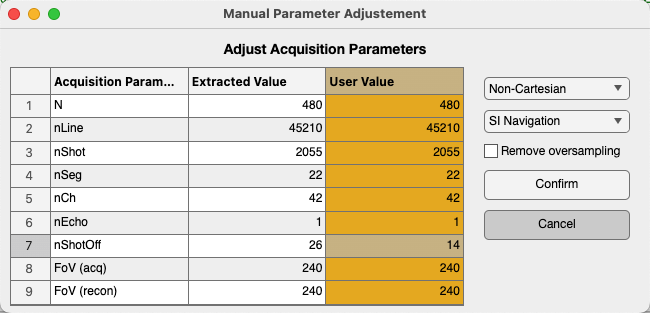

Reading Raw Data
================

Before any reconstruction or analysis, we need to parse k-space raw data into Python objects. However, different users may work with different raw data formats — such as Siemens Twix or ISMRMRD.

Monalisa provides two ready-to-use readers for these formats:
- Siemens raw data (Twix format)
- ISMRMRD format

If your data is in another format, the simplest solution is to **convert it to ISMRMRD**.

Basic Usage
------------

Using the data readers is easy. Monalisa provides the ``create_raw_data_reader`` function (MATLAB ``createRawDataReader``), which automatically detects the file format and returns the appropriate reader object. The readers need the ``io`` extra (``pip install -e ".[io]"``).

.. code-block:: python

   import monalisa as ml

   f = "/your/path/to/raw_data/rawdata.fileExtension"
   autoFlag = False  # False: interactive validation of the metadata; True: no window
   # Automatically create the appropriate reader
   reader = ml.create_raw_data_reader(f, autoFlag)

It is probable that the parser cannot correctly identify the metadata correctly, since different sequence implementation follow different conventions. That is why we prompt the user with a validation table where it is fundamental to correct any wrong entries:

Once the values in the yellow columns are selected, click confirm, to create the reader object. This reader object is passed as input to Monalisa functions, which then use it internally to access raw data and metadata.

With ``autoFlag = True`` no window is shown: correct the wrong entries in the code instead, for example ``reader.acquisitionParams.nShot_off = 14`` (any field of ``reader.acquisitionParams``). The screenshot is from MATLAB; the Python window has the same table.

Advanced Details for Developers
--------------------------------

Monalisa handles raw data abstraction using the ``RawDataReader`` interface class (``monalisa.io.RawDataReader``, MATLAB ``mleRawDataReader``). This base class defines a standard interface for reading raw MRI data in a vendor-agnostic way.

It defines two main methods:

- ``read_meta_data`` (MATLAB ``readMetaData``)
  Parses header information and acquisition parameters from the file, such as:
  - Number of coils
  - Acquisition lines
  - Echo counts
  - Field of view (FOV)  
  It also analyzes the signal to estimate when steady state is reached.

- ``read_raw_data`` (MATLAB ``readRawData``)
  Loads and reshapes the actual k-space data into a NumPy array. Typical dimensions include:
  - Coils
  - Readout points
  - Acquisition lines  
  This method can optionally remove unwanted or non–steady-state lines based on flags.

These methods provide a unified interface, abstracting vendor-specific details while ensuring compatibility across the Monalisa pipeline.

**Implemented Readers**

Monalisa currently includes two subclasses of ``RawDataReader``:

- ``SiemensReader``
  Reads Siemens raw data (Twix ``.dat``) with the **twixtools** library.
  Source: https://github.com/MattechLab/monalisa-python/blob/main/src/monalisa/io/_siemens_reader.py

- ``IsmrmrdReader``
  Supports the ISMRMRD file format (with the ``ismrmrd`` Python package).
  Source: https://github.com/MattechLab/monalisa-python/blob/main/src/monalisa/io/_ismrmrd_reader.py

**Note on mapVBVD and twixtools**

The MATLAB Siemens reader uses the external toolbox **mapVBVD**, originally developed by Philipp Ehses
(https://github.com/pehses/mapVBVD), in ``monalisa/third_part/twix_for_monalisa/``.
The Python reader uses **twixtools**, by the same author (https://github.com/pehses/twixtools).
These libraries are **not part of the core Monalisa toolbox**.

**Extending for Other Formats**

If you need to support a different file format, you have two options:

- Convert your dataset to ISMRMRD (recommended if possible)
- Implement a new subclass of ``RawDataReader`` and override:
  - ``read_meta_data``
  - ``read_raw_data``

Source for the base class:
https://github.com/MattechLab/monalisa-python/blob/main/src/monalisa/io/_raw_data_reader.py
