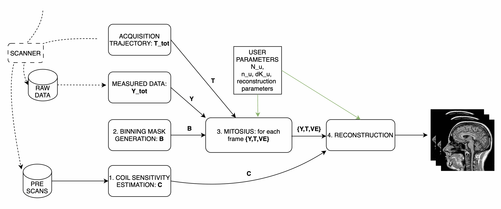

=====================================
Tutorial 1: Reconstruct MRI rawdata
=====================================

Welcome to this tutorial! In this guide, we will use **Monalisa** to reconstruct MRI raw data. In this tutorial we will work with some 3D radial brain data.
This tutorial aim to give you a first good experience with the toolbox, providing you with all the essential information to reconstruct your own data.
We'll start with a set of files:

- A **brain scan** dataset (the main scan).
- Two **prescans** for coil sensitivity estimation:
    - A **body coil** prescan.
    - A **head coil** prescan.

A Jupyter notebook and a Python script are provided to help us produce images step by step. The reconstruction process involves multiple steps illustrated in the figure below, in this tutorial we will walk you through each of them.

For this tutorial the repository is organized as follows:

.. code-block:: text

    monalisa-python/
    ├── examples/tutorial_1/
    │   ├── tutorial_1.ipynb  # the tutorial, step by step, with figures
    │   ├── tutorial_1.py     # the same steps as a script
    │   └── results/          # written by the tutorial
    ├── demo/data_demo/data_8_tutorial_1/
    │   ├── download_data.py  # downloads the data below
    │   ├── bodyCoil.dat      # this is the body coil prescan
    │   ├── brainScan.dat     # this is the actual brain data
    │   └── surfaceCoil.dat   # this is the brain coil prescan

To start working on this tutorial, and get the needed data you need to:

If you haven't done it already, you fist need to follow the installation guidelines (:doc:`1-2_installation`, with the ``io`` and ``notebook`` extras, or :doc:`5_docker`).

Download the data needed for tutorial 1, this can take a while depending on your internet connection (about 7.9 GB), and can be done with the ``download_data.py`` script:

.. code-block:: bash

    # Execute the script: Download the data
    python demo/data_demo/data_8_tutorial_1/download_data.py

You are now ready to follow the tutorial, in the notebook:

.. code-block:: bash

    jupyter lab examples/tutorial_1/tutorial_1.ipynb

or with the script (``--interactive`` opens the same windows as the MATLAB scripts, ``--show`` shows the results):

.. code-block:: bash

    python examples/tutorial_1/tutorial_1.py --data demo/data_demo/data_8_tutorial_1 --out results

The code below is the code of the notebook. It assumes

.. code-block:: python

    import os
    from pathlib import Path

    import matplotlib.pyplot as plt
    import numpy as np

    import monalisa as ml
    from monalisa.io import loadmat73, savemat73

    DATA = Path(os.environ.get("MONALISA_TUTORIAL_DATA", "../../demo/data_demo/data_8_tutorial_1"))
    OUT = Path("results")  # results of every step are saved here
    OUT.mkdir(exist_ok=True)

Step 1: Compute Coil Sensitivity
================================

The first step is to compute **coil sensitivity maps**, which describe how each coil "sees" the object being scanned.

The only parameter you can adjust is the **virtual Cartesian grid size** (`N_u`). In MATLAB, some pop-up windows ask you to confirm the acquisition parameters (which are already correct), and to select a box around the brain;
the notebook uses ``autoFlag=True`` instead (no window), and sets in the code the two corrections that the MATLAB tutorial makes in its dialogs: the same number of discarded shots (``nShot_off``) for both scans, and the trajectory type.

.. note::

    We recommend setting `N_u` between **48** and **96** for optimal results.

Script Overview:
-----------------
Below is the main structure of the coil sensitivity estimation:

.. code-block:: python

    # Create raw data readers
    bodyReader = ml.create_raw_data_reader(DATA / "bodyCoil.dat", True)
    surfaceReader = ml.create_raw_data_reader(DATA / "surfaceCoil.dat", True)
    nShotOff = max(bodyReader.acquisitionParams.nShot_off, surfaceReader.acquisitionParams.nShot_off)
    for r in (bodyReader, surfaceReader):
        r.acquisitionParams.nShot_off = nShotOff
        r.acquisitionParams.traj_type = "full_radial3_phylotaxis"

    # Cartesian grid spacing (dK_u) and grid size (N_u)
    dK_u = np.array([[1.0, 1.0, 1.0]]) / surfaceReader.acquisitionParams.FoV
    N_u = np.array([[48.0, 48.0, 48.0]])  # Adjust this value as needed

    # Compute Coil Sensitivity

    # 1. get low resolution data from the prescan files
    y_body, t, ve = ml.coil_sense_non_cart_data(bodyReader, N_u)
    y_surface = ml.coil_sense_non_cart_data(surfaceReader, N_u, nargout=1)

    # 2. estimate gridding matrix
    Gn, Gu, Gut = ml.traj_to_sparse_mat(t, ve, N_u, dK_u)
    # 3. We compute a binary mask to enhance our estimation
    # This mask should optimally only contain the whole imaged region
    mask = ml.coil_sense_non_cart_mask_automatic(y_body, Gn, True)

    # Estimate Coil Sensitivity
    # Reference coil sensitivity using the body coils. This is used as
    # a reference to estiamte the sensitivity of each head coil
    y_ref, C_ref = ml.coil_sense_non_cart_ref(y_body, Gn, mask, None)
    # Head coils sensitivities estimation using body coil reference
    C_prime = ml.coil_sense_non_cart_primary(y_surface, y_ref, C_ref, Gn, ve, mask)

    # Refine the coil sensitivity estimation
    nIter = 5
    C = ml.coil_sense_non_cart_secondary(y_surface, C_prime, y_ref, C_ref, Gn, Gu, Gut, ve, nIter, False)

    # Save Results
    savemat73(OUT / "coil_sensitivity_map.mat", {"C": C})

This script performs three main function calls:

1. **Compute a binary mask**
   A binary mask, ``mask``, is generated to filter out the contribution of noisy voxels from the estimation process.

2. **Calculate reference coil sensitivity**
   The body coil is used to calculate a reference coil sensitivity, which is an intermediate step in our computation.

3. **Compute individual coil sensitivities**
   Using the reference coil sensitivity, the script computes the individual coil sensitivities first estimate C_prime.

4. **Compute refined individual coil sensitivities**
    C_prime is further refined using an iterative optimization process.

After running the script, you can take a look at the generated maps, for instance with ``ml.show_image(C)``. These maps represent how different coils perceive the imaging field.
They are saved into a file that we will use during the reconsturctions.

Step 2: Binning
================

Binning is highly related to the study design. In the following we illustrate several very different binning strategies in increasing difficulty level.
The binnings need the acquisition parameters of the brain scan:

.. code-block:: python

    reader = ml.create_raw_data_reader(DATA / "brainScan.dat", True)
    p = reader.acquisitionParams
    nSeg, nLines = int(p.nSeg), int(p.nLine)
    nExcludeMeasures = int(p.nShot_off) * nSeg
    ts = np.ravel(np.asarray(p.timestamp, dtype=np.float64))
    timestampMs = (ts - ts.min()) * 2.5  # Siemens time stamps are in units of 2.5 ms
    si = np.arange(0, nLines, nSeg)      # first line of every shot (SI projection)

Step 2.1: allLines Binning - A Single Bin
==============================================================

The first binning strategy we will use is **allLines binning**, which groups all usable lines into a single bin. This is the simplest form of binning and serves as a baseline for more advanced strategies.

**Purpose:**
The goal of this step is to include all lines that are in the steady-state phase and exclude:

- **Non-steady-state lines**: These occur during the initial acquisition phase before the steady-state phase is reached.
- **SI projection lines**: Repeated measurements at the same spatial location (e.g., 1 line every `nSeg = 22`).

**Script Overview:**
We start by initializing a mask that includes all lines, excluding those that cannot be used for reconstruction. Here’s the Python implementation:

.. code-block:: python

    # Step 2: Simple Binning - Include All Steady-State Lines
    # Create a mask with all lines that are in steady state
    # (excluding the first few lines which may be non-steady-state)
    nbins = 1
    allLines = np.ones((nbins, nLines), dtype=bool)  # Include all lines except non steady state

    # Exclude non-steady-state lines
    allLines[0, :nExcludeMeasures] = False

    # Exclude repeated SI projection lines
    allLines[0, si] = False

**Visualization:**
To better understand the generated mask, we plot the binning mask. Different categories of points are displayed:

- **Red Points**: Non-steady-state lines.
- **Orange Points**: SI projection lines.
- **Green Points**: Steady-state lines included in the bin.

.. code-block:: python

    # Visualize the Binning Mask
    timeInSeconds = timestampMs / 1000
    i = np.arange(nLines)
    red = i < nExcludeMeasures                # not steady state
    orange = ~red & (i % nSeg == 0)           # SI projection
    green = ~red & ~orange

    fig, ax = plt.subplots()
    ax.scatter(timeInSeconds[orange], allLines[0, orange], 40, color=(1, 0.647, 0), label="SI point (Orange)")
    ax.scatter(timeInSeconds[red], allLines[0, red], 40, color="r", label="Not steady-state points (Red)")
    ax.scatter(timeInSeconds[green], allLines[0, green], 40, color="g", label="Other points (Green)")

    # Add labels and title
    ax.set_xlabel("Time (s)")
    ax.set_ylabel("Logical Mask Values (0 = exclude)")
    ax.set_title("allLine Binning Mask (4.15s to 5s)")
    ax.grid(True)
    ax.set_ylim(-0.1, 1.1)  # Binary y-axis
    ax.set_xlim(4.15, 5)    # Limit x-axis to the specified time range
    ax.set_xticks(np.arange(4.15, 5.001, 0.05))  # Adjust tick density within the range
    ax.legend(loc="best")
    plt.show()

**Interpretation of the Plot:**

- **Red Points**: Indicate non-steady-state lines that are excluded from reconstruction.
- **Orange Points**: Represent SI projection lines, excluded due to redundancy.
- **Green Points**: Indicate steady-state lines included in the reconstruction.

**Output:**
The mask generated in this step groups all steady-state lines into a single bin. This mask will be used as a reference for comparison in subsequent steps.

Step 2.2: Sequential Binning - 5-Second Temporal Bins
=========================================================================

The purpose of this step is to group the measured data into fixed temporal bins of 5 seconds each. This approach allows for systematic segmentation of the dataset while excluding non-steady-state measurements. Below are the details of the process:

Temporal Window Definition
--------------------------
- The temporal window for each bin is set to 5 seconds, defined as:

  .. code-block:: python

     temporalWindowSec = 5
     temporalWindowMs = temporalWindowSec * 1000

- Data is processed within this window size, converting the time to milliseconds for consistency with the timestamp measurements.

Exclude Non-Steady-State Measurements
-------------------------------------
- Non-steady-state measurements, such as the first few "off-shots" or specific artifacts, are excluded by adjusting the start time:

  .. code-block:: python

     startTime = timestampMs[nExcludeMeasures]  # first steady state line (0-based index)
     endTime = timestampMs[-1]

- The `startTime` ensures that the initial excluded data points are not considered during binning.

Binning Mask Creation
---------------------
- The number of temporal bins (`nMasks`) is calculated based on the duration of valid data and the size of the temporal window:

  .. code-block:: python

     totalDuration = endTime - startTime
     nMasks = int(np.floor(totalDuration / temporalWindowMs))

- An empty logical matrix (`sequentialBinningMask`) is initialized to store inclusion/exclusion information for each bin.

Filling the Binning Mask
------------------------
- For each bin, a mask is created to identify which measurements fall within the temporal window. This mask is then adjusted to exclude specific lines (e.g., SI projections or other artifacts) based on predefined rules.

  .. code-block:: python

     sequentialBinningMask = np.zeros((nMasks, nLines), dtype=bool)
     for i in range(nMasks):
         windowStart = startTime + i * temporalWindowMs
         windowEnd = windowStart + temporalWindowMs

         mask = (timestampMs >= windowStart) & (timestampMs < windowEnd)

         mask[si] = False  # exclude the SI projection lines

         sequentialBinningMask[i, :] = mask

     savemat73(OUT / "binning.mat", {"allLinesMask": allLines, "sequentialMask": sequentialBinningMask})

The notebook shows the temporal binning masks as an image (one row per bin), with ``plt.imshow(sequentialBinningMask, aspect="auto")``.

Step 3: Preparing the Data for Reconstruction (Mitosius)
========================================================

This step organizes the data into the correct format for the reconstruction algorithm. The key tasks in this stage include:

- **Loading the raw brain scan data.**

- **Computing trajectories and volume elements.**

- **Normalizing the data.**

- **Selecting a binning strategy.**

Mitosius Script Overview
------------------------
Below is a streamlined script for the Mitosius step. It prepares the data for reconstruction by leveraging previously computed **coil sensitivity maps** and **binning masks**.

.. code-block:: python

    # Load Raw Data and Compute Trajectories
    p.traj_type = "full_radial3_phylotaxis"
    y_tot = reader.read_raw_data(True, True)
    t_tot = ml.traj(p)
    ve_tot = ml.volume_element(t_tot, "voronoi_full_radial3")

    FoV = float(np.ravel(p.FoV)[0])
    N = int(FoV / 3)  # 3 mm voxels
    N_u = np.array([[N, N, N]], dtype=np.float64)
    dK_u = np.array([[1.0, 1.0, 1.0]]) / FoV
    C_N = ml.im_resize(C, [48, 48, 48], N_u)  # coil maps at the image resolution

    # Normalize the Data
    x_tot = ml.mathilda(y_tot, t_tot, ve_tot, C_N, N_u, N_u, np.array([[1.0, 1.0, 1.0]]) / 384)
    temp_im = np.abs(x_tot[:, :, N // 2])
    temp_roi = ml.roipoly(temp_im)  # draw the ROI; the notebook uses a centered disk instead
    normalize_val = np.mean(temp_im[temp_roi])
    y_tot = y_tot / normalize_val

    # Apply Mitosis, for each binning strategy
    nShot_off = int(p.nShot_off)
    for name, mask in {"allLines": allLines, "sequential": sequentialBinningMask}.items():
        m = np.reshape(mask, (mask.shape[0], nSeg, mask.shape[1] // nSeg), order="F")
        m = m[:, 1:, nShot_off:]  # drop the SI line and the discarded shots, as the raw data
        m = ml.point_reshape(m)
        y, t = ml.mitosis(y_tot, t_tot, m, nargout=2)
        y = ml.permute_to_col(y)
        ve = ml.volume_element(t, "voronoi_full_radial3")
        ml.mitosius_create(str(OUT / f"mitosius_{name}"), y, t, ve)

(As in the MATLAB tutorial, the normalization image is gridded with ``dK_u = 1/384``.)

Choosing a Binning Strategy
---------------------------
The MATLAB script includes a pop-up window allowing the user to choose between the **AllLines** and **Sequential** binning strategies; the Python code prepares both, one after the other:

- **AllLines Binning**: Groups all steady-state lines into a single bin.
- **Sequential Binning**: Groups the data into temporal bins of 5 seconds.

The appropriate binning mask is applied to the data, preparing it for reconstruction. Both binnings are prepared, to be able to reconstruct both.
The processed data is saved in the `mitosius_allLines` and `mitosius_sequential` directories. This output is now ready for use in the next step: **Reconstruction**.

The normalization region drawn with ``roipoly`` makes the result depend on the drawing. To be reproducible, the notebook (and the script, without ``--interactive``) uses a fixed region instead, a centered disk of radius N/4 in the central slice:

.. code-block:: python

    gx, gy = np.meshgrid(np.arange(1, N + 1), np.arange(1, N + 1), indexing="ij")
    temp_roi = (gx - (N / 2 + 1)) ** 2 + (gy - (N / 2 + 1)) ** 2 <= (N / 4) ** 2

Efficient Workflow: Local Preprocessing, HPC Reconstruction
============================================================

A key feature of the **Monalisa** workflow is its ability to minimize the computational and data transfer burdens. Instead of directly transferring raw datasets to a High-Performance Computing (HPC) system, **we recommend to preprocess the data locally on your laptop** until the **mitosius** step. This approach ensures that only the essential preprocessed data is transferred, significantly reducing file size and optimizing HPC utilization.

Why This Approach?
-------------------
MRI datasets are typically large, with raw data files often reaching several gigabytes. Transferring such large files to an HPC system can be time-consuming and inefficient. By running the **mitosius** preprocessing step locally, you can achieve the following:

- **Reduced Data Volume**: The **mitosius** step processes and organizes the raw data into a streamlined format, drastically reducing its size while retaining all critical information for reconstruction.
- **Efficient Reconstruction**: The preprocessed data is tailored for computationally intensive reconstruction algorithms, enabling faster execution on HPC systems.
- **Lower Costs**: Fewer data transfers mean reduced network bandwidth usage, saving your time. Running the preprocessing

Workflow Summary:
------------------
1. **Run the mitosius step locally**:

   - Preprocess your raw data using the provided notebook or script.

   - Save the resulting files in a lightweight format suitable for reconstruction.

2. **Transfer the preprocessed data to HPC, if you have one**:

   - Use secure and efficient transfer methods (e.g., `scp`, `rsync`, or cloud-based storage) to move the smaller dataset to the HPC system.

3. **Perform heavy reconstructions on HPC**:

   - Use Monalisa’s advanced reconstruction algorithms (e.g., Mathilda, Sensa, compressed sensing) to generate high-quality images. The Docker image (:doc:`5_docker`) runs the same environment there.

4. **Download and analyze results locally**:

   - Retrieve the reconstructed images and analyze them on your laptop or workstation.

This hybrid approach leverages the strengths of both local and HPC envsironments, providing an optimal balance between convenience and computational power.

.. tip::

    Ensure you carefully verify the preprocessed data before transferring it to the HPC system. Small errors in the **mitosius** step can propagate into reconstruction, leading to suboptimal results.

By following this workflow, you can maximize efficiency and focus on obtaining the highest quality MRI reconstructions with minimal hassle.

Step 4: Running Reconstructions
===============================

Reconstruction Methods Overview
-------------------------------
.. list-table::
   :header-rows: 1
   :align: center

   * - **Method**
     - **Description**
     - **Key Parameters**
     - **Use Case**
   * - **Gridded Reconstruction (Mathilda)**
     - Basic reconstruction using gridding.
     - `N_u`: Grid size
       `dK_u`: Grid spacing
     - Quick reconstruction for visual inspection or debugging.
   * - **Iterative Sense Reconstruction (Sensa)**
     - Exploits coil sensitivity maps for improved image quality.
     - `C`: Coil sensitivity maps
       `nCGD`: Number of conjugate gradient iterations
       `nIter`: Number of iterations.
     - High-quality images with moderate computing requirements.
   * - **Compressed Sensing (TevaMorphosia_chain)**
     - Reduces undersampling artifacts by temporal regularization (1 temporal dimension).
     - `delta`: Regularization weight
       `rho`: Convergence parameter
       `nIter`: Number of iterations
       `Tu, Tut`: Deformation matrices. If not empty, motion compensaiton is performed.
     - When data is undersampled and/or sparsity of temporal gradient is expected.

Reconstruction Implementation
-----------------------------

The final step is to reconstruct the images using various methods.
First we need to load the data prepared previously:

.. code-block:: python

    d = str(OUT / "mitosius_allLines")
    y  = ml.mitosius_load(d, "y")
    t  = ml.mitosius_load(d, "t")
    ve = ml.mitosius_load(d, "ve")

Then we need to decide set some parameters:

.. code-block:: python

    FoV = float(np.ravel(p.FoV)[0])  # Field of View
    matrix_size = int(FoV / 3)        # Max nominal spatial resolution
    N_u = np.array([[matrix_size] * 3], dtype=np.float64)
    n_u = N_u
    dK_u = np.array([[1.0, 1.0, 1.0]]) / FoV
    C = loadmat73(OUT / "coil_sensitivity_map.mat")["C"]
    # Adjust grid size for coil sensitivity maps
    C = ml.im_resize(C, [48, 48, 48], N_u)

    # For Iterative Sense
    nIter = 30
    witness_ind = None
    nCGD = 4
    ve_max = 10 * np.prod(dK_u)

    # For CS recon
    nIter = 30
    delta = 0.1
    rho = 10 * delta
    witness_ind = np.arange(1, nIter + 1, 3)  # Only track one out of three steps
    nCGD = 4

Finally we can run the reconstruction, many options are available:

1. **Gridded Reconstruction (Mathilda)**, of the single bin of ``mitosius_allLines``, and of the first 8 bins of ``mitosius_sequential``:

   .. code-block:: python

      x0 = ml.mathilda(y[0, 0], t[0, 0], ve[0, 0], C, N_u, N_u, dK_u)

      nFr = 8
      d = str(OUT / "mitosius_sequential")
      y, t, ve = (ml.mitosius_load(d, k)[:nFr] for k in ("y", "t", "ve"))
      x1 = [ml.mathilda(y[i, 0], t[i, 0], ve[i, 0], C, N_u, N_u, dK_u) for i in range(nFr)]

2. **Iterative Sense Reconstruction (Sensa)**, frame by frame, started from the gridded images:

   .. code-block:: python

      from monalisa.optim import WitnessInfo

      Gu, Gut = ml.traj_to_sparse_mat(t, ve, N_u, dK_u, nargout=2)
      x_sensa = [ml.sensa(x1[i], y[i, 0], ve[i, 0], C, Gu[i, 0], Gut[i, 0], n_u, nCGD, ve_max, nIter,
                          WitnessInfo(f"sensa_frame_{i + 1}", witness_ind)) for i in range(nFr)]

3. **Compressed Sensing**, the 8 frames together (a chain: an object array of shape ``(nFr, 1)``):

   .. code-block:: python

      x1_cell = np.empty((nFr, 1), dtype=object)
      for i in range(nFr):
          x1_cell[i, 0] = x1[i]
      x_cs = ml.teva_morphosia_chain(x1_cell, None, None, y, ve, C, Gu, Gut, n_u, None, None,
                                     delta, rho, "normal", nCGD, ve_max, nIter,
                                     WitnessInfo("tevaMorphosia_d0p1_r1_nCGD4", witness_ind))

4. **Motion-Compensated Reconstruction (TevaMorphosia)**: the same call with deformation matrices ``Tu, Tut``,
   estimated from a first reconstruction (for instance ``x_cs``) as described in the section
   *Deformation-Fields* of :doc:`2-2_reconstruction_calls`:

   .. code-block:: python

      DF = ml.im_deform_field_chain_im_reg_demons23(x_cs, n_u, "curr_to_prev", 500, 1, None)
      Tu, Tut = ml.im_deform_field_to_sparse_mat(DF, N_u, None, True)
      x_motion = ml.teva_morphosia_chain(x_cs, None, None, y, ve, C, Gu, Gut, n_u, Tu, Tut,
                                         delta, rho, "normal", nCGD, ve_max, nIter,
                                         WitnessInfo("tevaMorphosia_motion", witness_ind))

The images are shown with ``ml.show_image``: ``ml.show_image(x_cs)`` in the notebook (sliders
for the slice and the frame), ``ml.show_image(x0, "ortho")`` in a window with three linked slices
and a 3D view, and several reconstructions side by side in one window:

.. code-block:: python

   v = ml.show_image(x1, "window", name="gridded x1")
   ml.show_image(x_sensa, viewer=v, name="Sensa")
   ml.show_image([x_cs[i, 0] for i in range(nFr)], viewer=v, name="TevaMorphosia")

.. tip::

    If the reconstruction is too memory demanding (OOM error), you can consider:

    - Reducing the matrix size (and the nominal resolution of the reconstruction)
    - Migrating to high computing resources, which might be needed for advanced reconstructions.

    The memory bottleneck is the FFT computation.

Congratulations, you just completed your first reconstructions with Monalisa! You should be able to observe the magic of CS reconstructions, enhancing the image quality significantly. Observe how eye displacements become observable in the image reconstructed using TevaMorphosia.

Summary
-------
This tutorial demonstrated the end-to-end workflow for reconstructing MRI data using **Monalisa**. From preprocessing to advanced reconstruction techniques, you now have all the tools to generate high-quality images. Experiment with the methods and parameters to optimize your results.

The coil sensitivity maps, binnings, mitosius and gridded reconstructions of the Python tutorial match those of the MATLAB tutorial up to single-precision rounding, see :doc:`9-3_validation_tutorial_1`.
